# Spatial SQL

Spatial SQL is an extension of the SQL language that allows users to store, query, analyze, and manipulate geographic and geometric data directly within a database.

> **Official Documentation :** [DuckDB - Spatial Extension](https://duckdb.org/docs/stable/core_extensions/spatial/overview)

## 1. Loading Geospatial Data

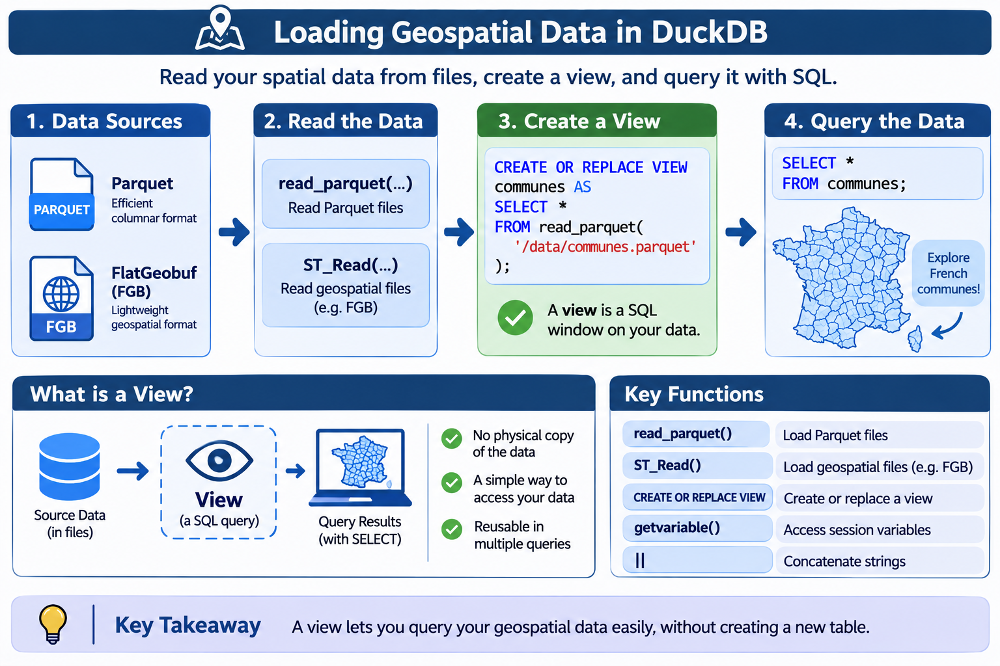

::: tip Important Difference Between VIEW & TABLE
A VIEW does not materialize data. It stores an SQL definition that allows users to access the source data. A TABLE, on the other hand, physically stores the data resulting from its creation.
:::

:::info EXAMPLE
```sql
CREATE OR REPLACE VIEW communes AS SELECT * FROM read_parquet(getvariable('curated'))
CREATE OR REPLACE VIEW communes_fgb AS SELECT * FROM ST_Read(getvariable('curated') || '/communes-fr.fgb')
```
:::

### `CREATE OR REPLACE VIEW`

SQL statement used to create a view from the result of an SQL query. If the view already exists, it is replaced.

### `read_parquet()`

DuckDB function used to read data from a Parquet file and make it directly available in an SQL query.

### `ST_Read()`

Function from the DuckDB Spatial extension (`spatial`) used to read geospatial data from various file formats supported by GDAL, including **FlatGeobuf (FGB)**.

### `getvariable()`

DuckDB function used to retrieve the value of a variable defined in the current SQL session.

::: details EXAMPLE: LOADING FRENCH COMMUNES FROM PARQUET AND FLATGEOBUF FILES

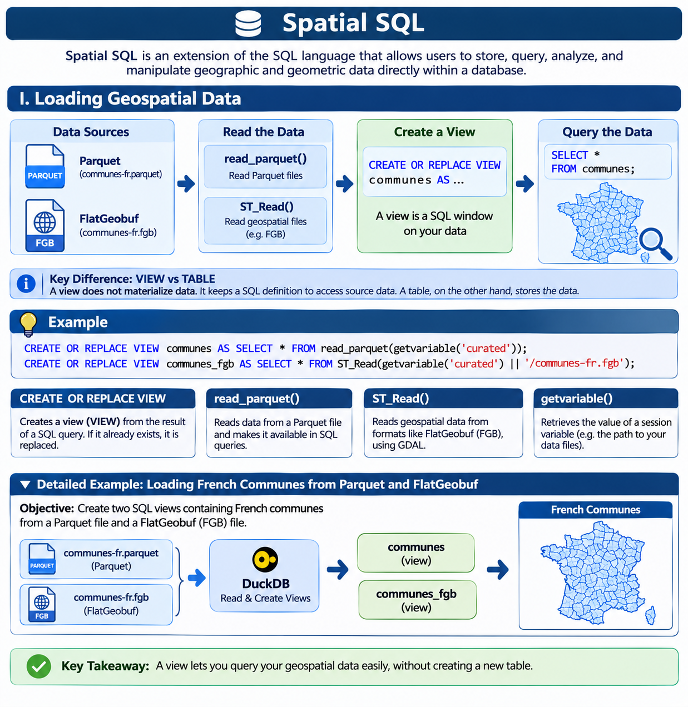

**OBJECTIVE :** OBJECTIVE: Create two SQL views containing French commune data from two different geospatial files: a Parquet file and a FlatGeobuf (FGB) file.

These views make it possible to query the data directly in DuckDB without physically importing their contents into new tables.

### 1. LOADING DATA FROM A PARQUET FILE

```sql
CREATE OR REPLACE VIEW communes AS
SELECT *
FROM read_parquet(
    getvariable('curated') || '/communes-fr.parquet'
);
```

**Query breakdown :**

1. `CREATE OR REPLACE VIEW communes` : Creates a view named `communes`. Creates a view named communes. If it already exists, it is replaced.
2. `AS SELECT` : Indicates that the contents of the view are defined by the result of the `SELECT` query.
3. `SELECT *` : Selects all columns and all records from the Parquet file.
4. `read_parquet()` : Reads the data contained in the `communes-fr.parquet` parquet file and makes it available to the SQL query.
5. `getvariable('curated')` : Retrieves the path of the curated directory defined in the DuckDB session variables.
6. `|| '/communes-fr.parquet'` : Concatenates the directory path with the file name to build the full file path.

**Result :** The `communes` view provides access to the French commune data stored in the `communes-fr.parquet` file.

### 2. LOADING DATA FROM A FLATGEOBUF (FGB) FILE

```sql
CREATE OR REPLACE VIEW communes_fgb AS
SELECT *
FROM ST_Read(
    getvariable('curated') || '/communes-fr.fgb'
);
```

**Query breakdown :**

1. `CREATE OR REPLACE VIEW communes_fgb`: Creates a view named `communes_fgb`. If it already exists, it is replaced.
2. `AS SELECT`: Indicates that the contents of the view are defined by the result of the `SELECT` query.
3. `SELECT *`: Selects all columns and all records from the FlatGeobuf file.
4. `ST_Read()`: Function from the DuckDB Spatial extension used to read the geospatial data contained in the `communes-fr.fgb` file.
5. `getvariable('curated')`: Retrieves the path of the `curated` directory defined in the DuckDB session variables.
6. `|| '/communes-fr.fgb'`: Concatenates the directory path with the file name to build the full file path.

**Result:** The `communes_fgb` view provides access to the French commune data stored in the `communes-fr.fgb` file.

### 3. VERIFYING THE VIEW CONTENTS
To check that both views have been created successfully and provide access to the data:

**View based on the Parquet file:**
```sql
SELECT *
FROM communes;
```

**View based on the FlatGeobuf file:**
```sql
SELECT *
FROM communes_fgb;
```

These queries display the French commune data from the Parquet and FlatGeobuf files, respectively.
:::

## 2. Creating and Manipulating Geometries

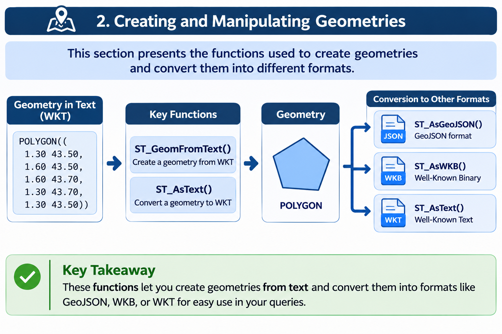

### `ST_GeomFromText()`

Spatial SQL function that converts a geometry described in text format ([WKT – Well-Known Text](https://www.ibm.com/docs/en/i/7.5.0?topic=formats-well-known-text-wkt-format)) into a geometric object that can be used for geographic and spatial operations.

::: details EXAMPLE: CREATING A GEOGRAPHIC ZONE AROUND TOULOUSE

**OBJECTIVE:** Create a table called `zone` containing a polygon that roughly defines the Toulouse metropolitan area. This zone will serve as a geographical reference boundary for future spatial operations and queries.

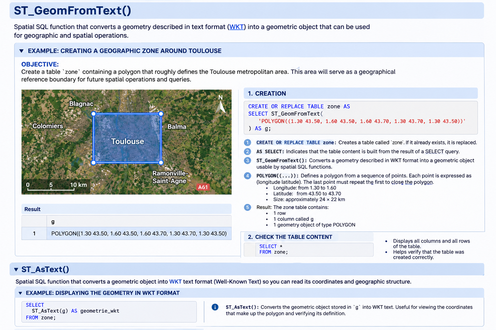

#### 1. CREATION

```sql
CREATE OR REPLACE TABLE zone AS
SELECT ST_GeomFromText(
    'POLYGON((1.30 43.50, 1.60 43.50, 1.60 43.70, 1.30 43.70, 1.30 43.50))'
) AS g;
```

1. `CREATE OR REPLACE TABLE zone`: Creates a table named `zone`. If the table already exists, it is replaced.
2. `AS SELECT`: Indicates that the table content is generated from the result of a `SELECT` query.
3. `ST_GeomFromText()`: Converts a geometry described in WKT (Well-Known Text) format into a geometric object that can be processed by spatial SQL functions.
4. `POLYGON((...))`: Defines a polygon using a sequence of points. Each point is expressed as `(longitude latitude)`. The last point must repeat the first point's coordinates to close the polygon.

   The resulting area is an approximate geographical rectangle:

   - **Longitude:** from 1.30 to 1.60
   - **Latitude:** from 43.50 to 43.70
   - **Dimensions:** approximately 24 × 22 km

5. **Result:** The `zone` table contains:

   - 1 row
   - 1 column named `g`
   - 1 geometric object of type `POLYGON`

The `g` column therefore stores the polygon representing the geographical area defined above.

#### 2. VERIFYING THE TABLE CONTENT

```sql
SELECT *
FROM zone;
```

- Displays all columns and all rows in the table.
- Allows you to verify that the table has been created successfully.

:::

### `ST_AsText()`

Spatial SQL function that converts a geometric object into WKT (Well-Known Text) format, allowing you to read its coordinates and geographical structure.

::: details EXAMPLE: DISPLAYING THE GEOMETRY IN WKT FORMAT

```sql
SELECT
    ST_AsText(g) AS geometry_wkt
FROM zone;
```

`ST_AsText()`: Converts the geometric object stored in `g` into WKT text. This is useful for displaying the coordinates that make up the polygon and verifying its definition.

:::

## 3. Spatial Operations

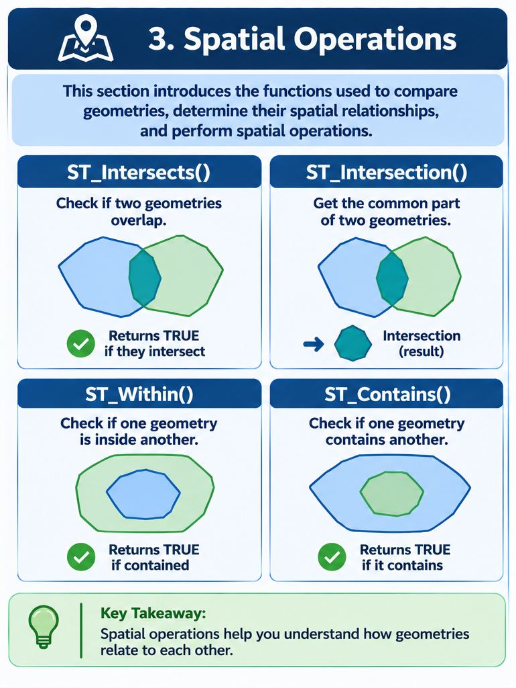

### `ST_Intersects()`

Spatial SQL function that checks whether two geometries intersect or share at least one point. It returns `TRUE` if an intersection exists, and `FALSE` otherwise.

::: details EXAMPLE: SELECTING MUNICIPALITIES LOCATED WITHIN THE TOULOUSE AREA

**OBJECTIVE:** Create a table called `zone_communes` containing only the municipalities whose geometries intersect the geographical area of Toulouse previously defined in the `zone` table.

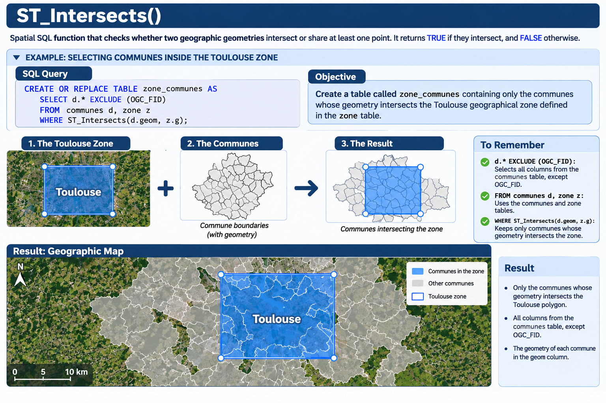

#### 1. SQL QUERY

```sql
CREATE OR REPLACE TABLE zone_communes AS
SELECT d.* EXCLUDE (OGC_FID)
FROM communes d, zone z
WHERE ST_Intersects(d.geom, z.g);
```

#### 2. UNDERSTANDING THE QUERY

1. `d.* EXCLUDE (OGC_FID)`: Selects all columns from the `communes` table (identified by the alias `d`), except for the `OGC_FID` column.

2. `FROM communes d, zone z`: Specifies the two tables used in the query:
   - `communes d`: Table containing the municipalities and their geometries. The alias `d` provides a shorter reference to this table.
   - `zone z`: Table containing the geographical polygon representing the Toulouse area. The alias `z` provides a shorter reference to this table.

3. `WHERE ST_Intersects(d.geom, z.g)`: Filters the municipalities according to whether their geometries intersect the geographical area:
   - `d.geom`: Geometry of each municipality.
   - `z.g`: Geometry of the polygon representing the Toulouse area.
   - `ST_Intersects()`: Checks whether a municipality's geometry intersects the polygon. Only municipalities that satisfy this condition are retained.

#### 3. RESULT

The `zone_communes` table contains:

- Only municipalities whose geometries intersect the Toulouse polygon.
- All columns from the `communes` table, except for `OGC_FID`.
- The geometry of each municipality, stored in the `geom` column.
:::

### `ST_Within()`

Spatial SQL function that checks whether a geometry is entirely within another geometry. It returns `TRUE` if the first geometry is completely contained within the second, and `FALSE` otherwise.

::: details EXAMPLE

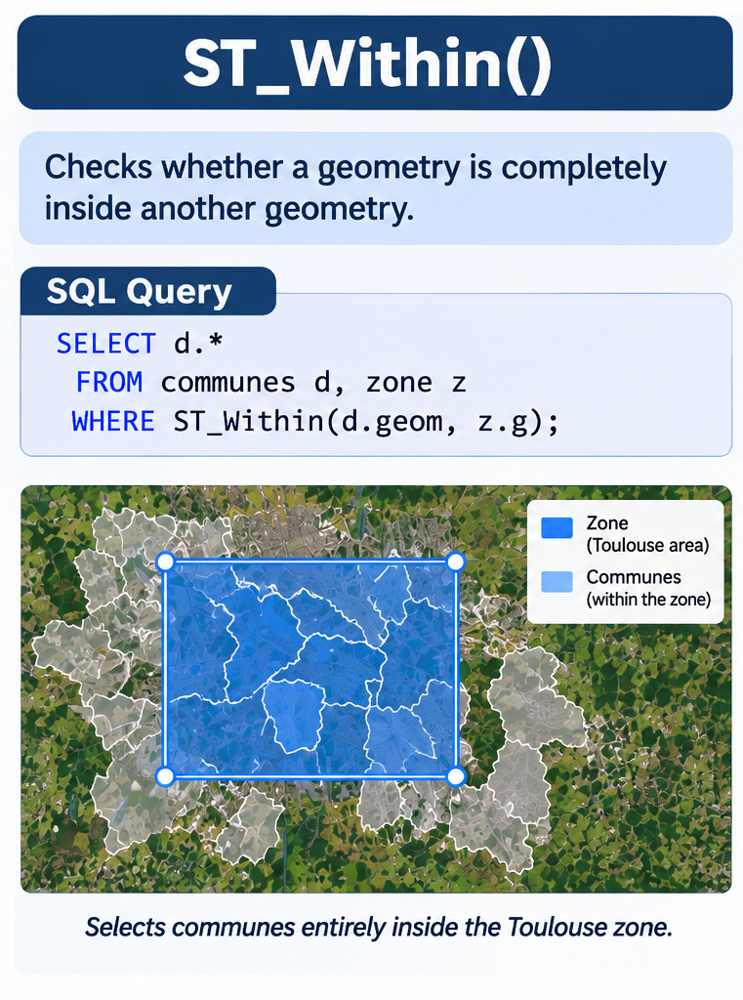

```sql
SELECT d.*
FROM communes d, zone z
WHERE ST_Within(d.geom, z.g);
```
:::

### `ST_Contains()`

Spatial SQL function that checks whether a geometry completely contains another geometry. It returns `TRUE` if the second geometry is entirely within the first, and `FALSE` otherwis

::: details EXAMPLE

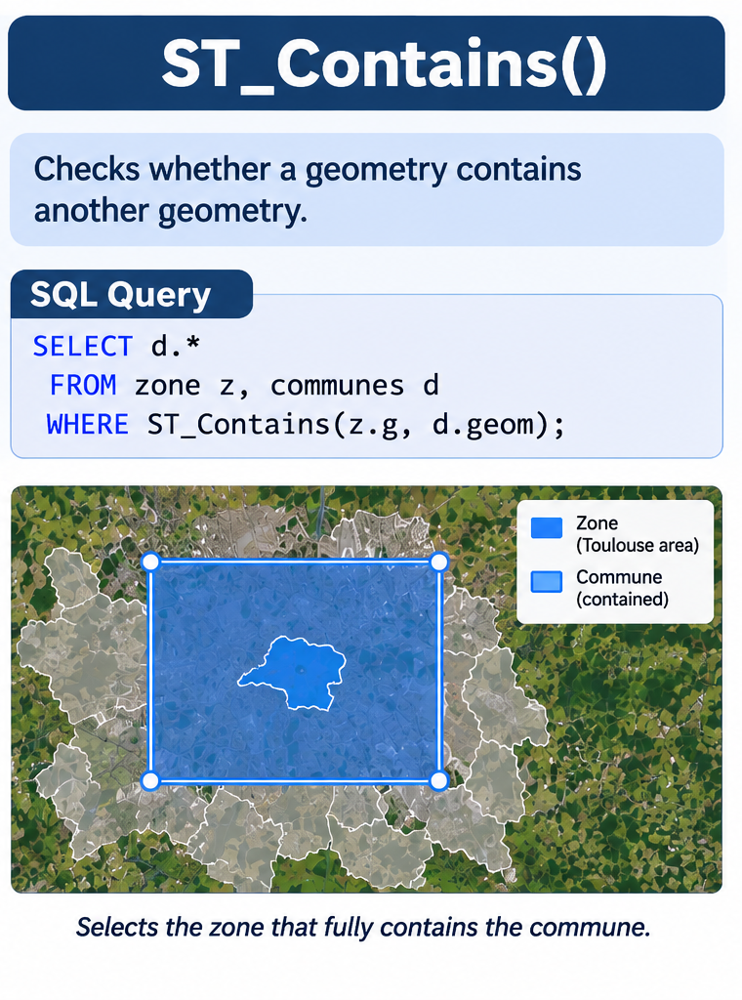

```sql
SELECT d.*
FROM zone z, communes d
WHERE ST_Contains(z.g, d.geom);
```
:::

## 4. Coordinate System Transformation

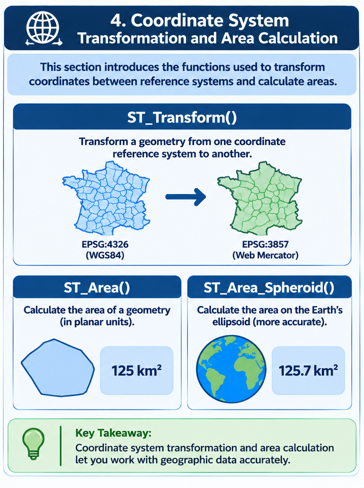

### `ST_Transform()`

Spatial SQL function that transforms a geometry from one coordinate reference system (CRS) to another, without changing its actual geographical shape.

It allows you, for example, to convert projected coordinates into geographic coordinates, or vice versa.

::: details EXAMPLE: TRANSFORMING THE GEOMETRIES OF RÉUNION ISLAND INTO WGS84

**OBJECTIVE:** Transform the geometries in the Réunion Island population dataset from coordinate reference system EPSG:2975 to EPSG:4326 (WGS84).

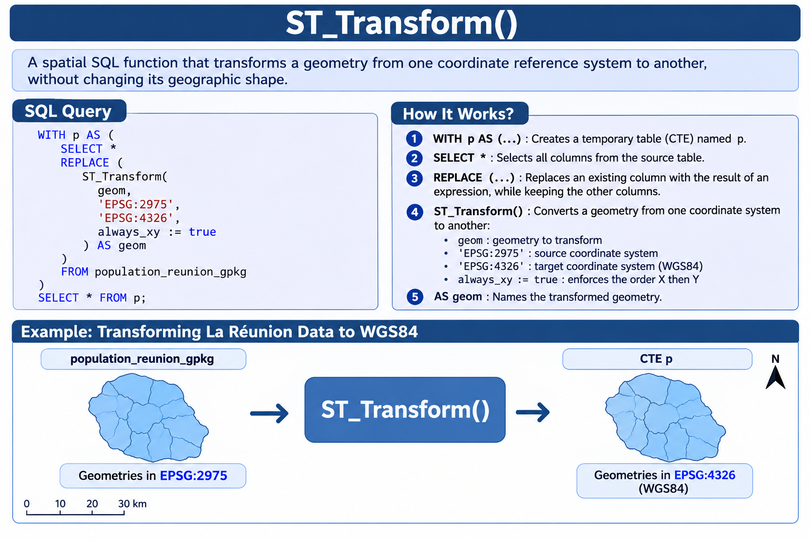

```sql
WITH p AS (
    SELECT *
    REPLACE (
        ST_Transform(
            geom,
            'EPSG:2975',
            'EPSG:4326',
            always_xy := true
        ) AS geom
    )
    FROM population_reunion_gpkg
)
SELECT *
FROM p;
```

**QUERY BREAKDOWN:**

1. `WITH p AS (...)`: Creates a temporary named expression called `p` (CTE – Common Table Expression), which can be used in the following query.
2. `SELECT *`: Selects all columns from the source table.
3. `REPLACE (...)`: Replaces an existing column with the result of an expression while preserving all other columns.
4. `ST_Transform()`: Transforms a geometry from one coordinate reference system to another:
   - `geom`: Geometry to be transformed.
   - `'EPSG:2975'`: Source coordinate reference system.
   - `'EPSG:4326'`: Target coordinate reference system (WGS84).
   - `always_xy := true`: Enforces the X-then-Y axis order during the transformation.
5. `AS geom`: Assigns the name `geom` to the transformed geometry.

**RESULT:** The CTE `p` contains the population data with their geometries transformed into EPSG:4326.
:::

### `ST_Area()`

Spatial SQL function that calculates the planar area of a polygon geometry.

The result is expressed in the squared units of the coordinate reference system (CRS) used by the geometry.

::: details EXAMPLE: CALCULATING THE AREA OF POPULATION GRID CELLS

**OBJECTIVE:** Calculate the area of the population grid cells in Réunion Island using their geometries projected in EPSG:2975.

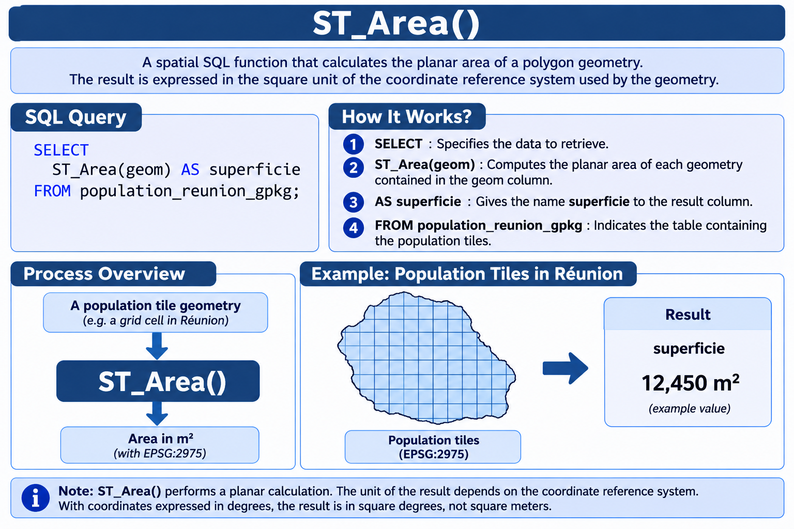

```sql
SELECT
    ST_Area(geom) AS area
FROM population_reunion_gpkg;
```

**QUERY BREAKDOWN:**

1. `SELECT`: Specifies the data to retrieve.
2. `ST_Area(geom)`: Calculates the planar area of each geometry stored in the `geom` column.
3. `AS area`: Assigns the name `area` to the column containing the calculated values.
4. `FROM population_reunion_gpkg`: Specifies the table containing the population grid cells.

**RESULT:** A column named `area` containing the calculated area of each grid cell.

Since EPSG:2975 uses meters as its unit of measurement, the result is expressed in square meters (m²).

**NOTE:** `ST_Area()` performs a planar area calculation. The unit of the result depends on the coordinate reference system. When coordinates are expressed in degrees, the result is in square degrees, not square meters.
:::